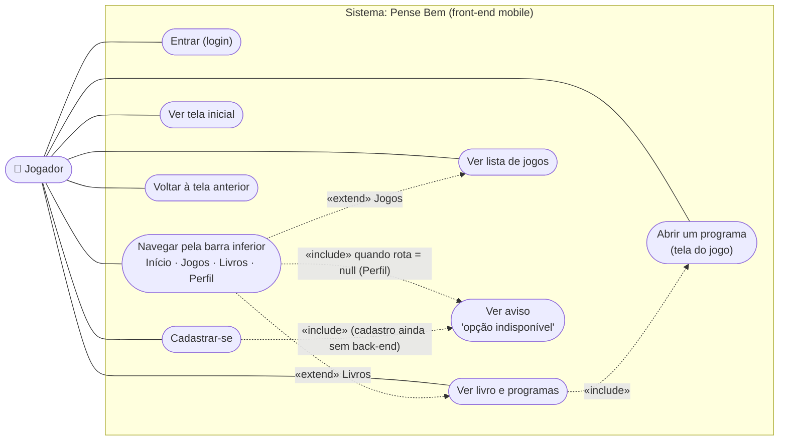
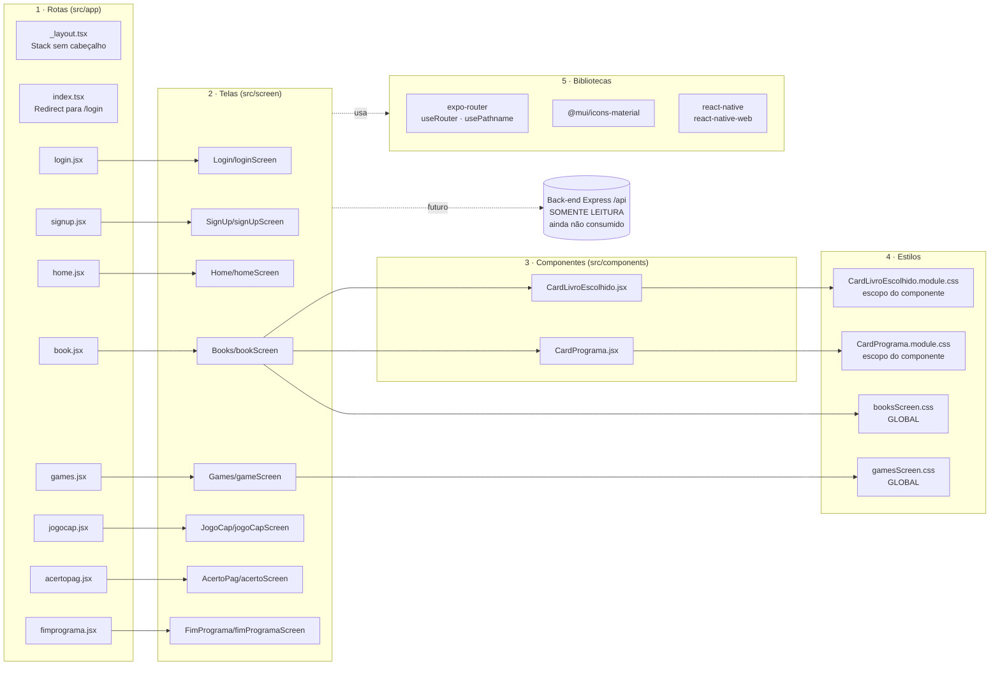
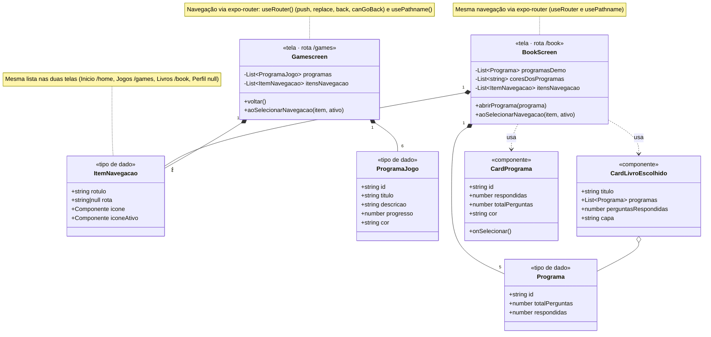
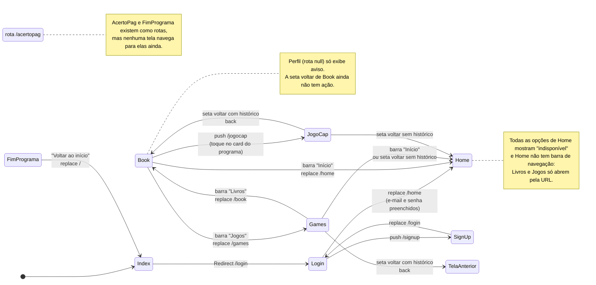
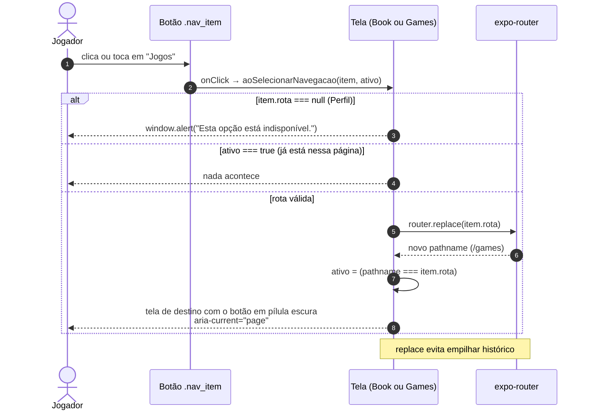
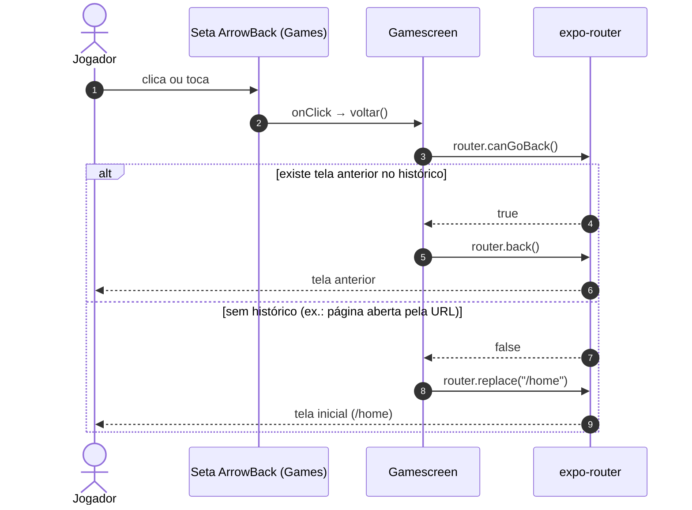
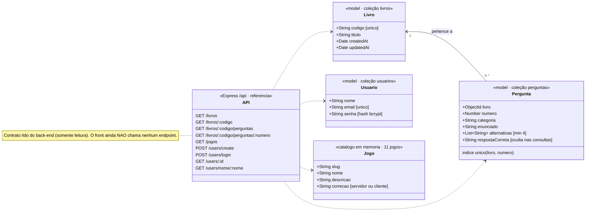

# Pense Bem (Senna) · Documentação UML do Front-end

Documentação do front-end (`front/`) em UML. Todos os diagramas foram montados a partir do **código real** do projeto
(Expo + React Native + Expo Router). O back-end (`back/`) aparece apenas como **referência de leitura**: nada nele foi alterado.

> **Como visualizar:** os blocos `mermaid` abaixo renderizam no GitHub e na prévia do VS Code (extensão *Markdown Preview Mermaid Support*).
> Cada diagrama também está exportado em PNG em `img/` (para anexar no trabalho) e o texto-fonte está em `src/*.mmd`.
> Mermaid não tem notação nativa de casos de uso e componentes, então esses dois diagramas usam `flowchart` seguindo a convenção UML.

## Sumário

| # | Diagrama | Tipo UML | Imagem |
|---|----------|----------|--------|
| 1 | Casos de uso | Casos de uso | `img/01-casos-de-uso.png` |
| 2 | Arquitetura em camadas | Componentes | `img/02-arquitetura.png` |
| 3 | Classes do front-end | Classes | `img/03-classes-front.png` |
| 4 | Fluxo de telas | Máquina de estados | `img/04-fluxo-telas.png` |
| 5 | Navegação pela barra inferior | Sequência | `img/05-sequencia-barra.png` |
| 6 | Seta voltar da tela Jogos | Sequência | `img/06-sequencia-voltar.png` |
| 7 | Domínio do back-end (referência) | Classes | `img/07-dominio-backend.png` |

---

## 1. Casos de uso

Mostra o que o jogador consegue fazer hoje no app. "Cadastrar-se" e "Perfil" aparecem ligados ao aviso de indisponível porque ainda não há integração/página.

## 2. Arquitetura em camadas (componentes)

Cada arquivo em `src/app` (rota) apenas reexporta uma tela de `src/screen`. As telas usam componentes e estilos. Atenção ao detalhe dos **CSS globais**:
`booksScreen.css` e `gamesScreen.css` são importados como efeito colateral e valem para o app inteiro (todas as páginas carregam os dois).

## 3. Diagrama de classes do front-end

`BookScreen` e `Gamescreen` têm a **mesma lista de 4 itens de navegação** (`itensNavegacao`). Os tipos de dado são estruturas de objeto do JavaScript (não são classes reais), e
as telas são componentes funcionais de React; o diagrama usa estereótipos para deixar isso explícito.

## 4. Fluxo de telas

Navegação real implementada hoje (verificada nas chamadas `router.push/replace/back`).

## 5. Sequência: navegação pela barra inferior

Regra única, igual nas telas Livros e Jogos. Rotas da barra: **Início** `/home` · **Jogos** `/games` · **Livros** `/book` · **Perfil** `null` (sem página).

## 6. Sequência: seta voltar na tela Jogos

## 7. Domínio do back-end (somente referência)

Contrato lido de `back/` sem modificar nada. **O front ainda não consome a API.**

---

## Regras do projeto respeitadas

- Back-end intocado: nenhum arquivo de `back/` foi alterado, criado ou removido.
- Arquitetura preservada: rotas em `src/app`, telas em `src/screen`, componentes em `src/components`.
- O caminho de uma rota é o **nome do arquivo** em `src/app`: `book.jsx` → `/book`, `games.jsx` → `/games`, `home.jsx` → `/home`.
  (`/livros` e `/jogos` são nomes de endpoints da API, **não** rotas do front.)
- A barra usa `router.replace` (e não `push`) para trocar de aba sem empilhar histórico.

## Pontos em aberto (não implementados, listados para transparência)

1. Home ainda não leva a Livros e Jogos (todas as opções mostram "indisponível").
2. A seta voltar da tela **Livros** ainda não tem ação.
3. Perfil não tem página (`rota: null`).
4. `AcertoPag` e `FimPrograma` existem como rotas, mas nenhuma tela navega para elas.
5. Nenhuma tela chama a API do back-end.
6. `booksScreen.css` e `gamesScreen.css` declaram **classes iguais** (`.nav_item`, `.navigationBar_games`, `.header_top`...) com valores diferentes.
   Como ambos são globais e `gamesScreen.css` é carregado por último, o estilo do Games prevalece nas duas telas.
   A barra fica idêntica nas duas (por isso nada foi alterado), mas o ideal futuro é extrair a barra para um componente único.
